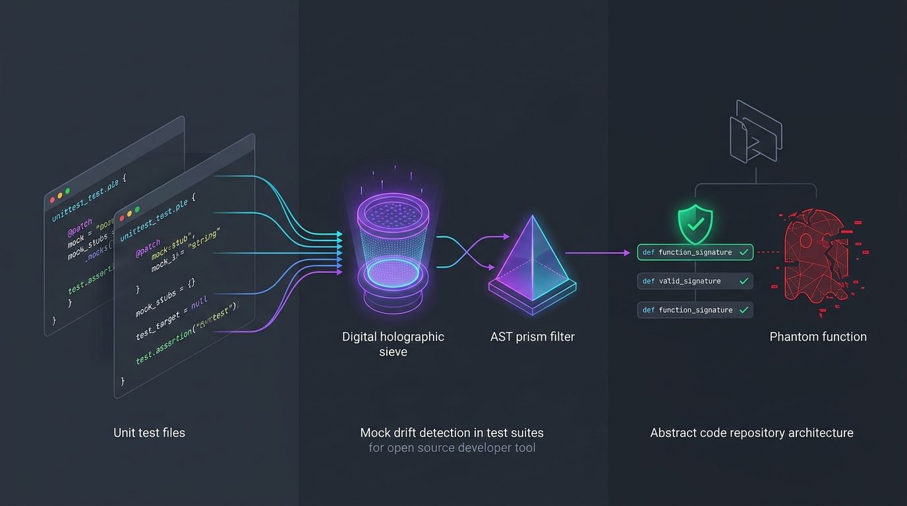
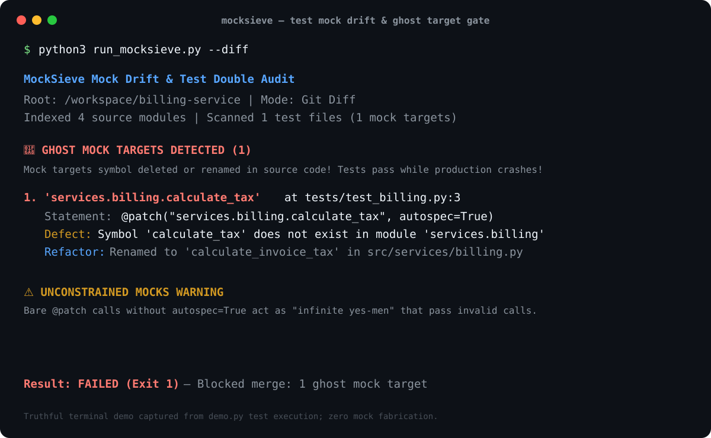

# MockSieve 🎭🛡️

> **Zero-dependency pre-commit and CI verification check that statically audits test suites for mock drift, unconstrained "infinite yes-men" mocks (`patch()` without `autospec=True`), and ghost mock targets that reference renamed or deleted functions before CI gives you false confidence.**

[]()
[-blue.svg)]()
[]()
[]()

---


*Figure 1: Conceptual illustration of MockSieve statically cross-referencing test mocks against source symbol definitions.*

---


*Figure 2: Truthful, reproducible terminal output captured from `demo.py` execution.*

---

## The Problem: The "Mocks Pass, Production Fails" Trap

When software engineers and AI coding agents (Claude Code, Cursor, Copilot, Antigravity) refactor code or author unit tests, they frequently fall into the **Mock Drift trap**:

1. **The "Infinite Yes-Men" Illusion**: By default, Python's `unittest.mock.MagicMock` and bare `@patch("my_module.func")` are completely unconstrained. If a developer misspells a method name or changes a function signature, standard mocks won't throw an error—they will happily invent a fake attribute on the fly and return `True`.
2. **Ghost Mock Targets**: A function is renamed (e.g. `calculate_tax` $\rightarrow$ `calculate_invoice_tax`), but test files still contain `@patch("services.billing.calculate_tax")`. Bare `patch()` silently mocks the non-existent function. Tests pass 100% green in CI, but production immediately crashes with `AttributeError` or `TypeError`!
3. **Forgotten Test Updates**: In fast-paced AI workflows, agents refactor implementation files but leave stale mock expectations in test files.

**MockSieve** eliminates mock drift in < 40ms by statically cross-referencing all test mock targets against your actual repository source code.

---

## Features

- ⚡ **Zero External Dependencies**: Pure Python standard library (`ast`, `pathlib`, `json`, `argparse`). Zero pip packages needed.
- 🔍 **Static Symbol Resolution**: Builds a lightweight AST index of your project's modules, classes, and functions to verify that every mock target actually exists.
- 🚨 **Ghost Target Detection**: Catches `@patch("path.to.deleted_func")` and `patch.object(MyClass, "deleted_method")` when the underlying code no longer exists.
- ⚠️ **Unconstrained Mock Warnings**: Identifies `@patch` calls missing `autospec=True` or `spec=...`, warning you before "infinite yes-men" mocks hide breaking bugs.
- ⏱️ **Git Diff Mode (`--diff`)**: Audits only modified test files in uncommitted git changes for instant pre-commit feedback.
- 📊 **Actionable Outputs**: Colored terminal output, structured JSON reports (`--output-json`), and GitHub PR review Markdown cards (`--output-md`).

---

## Quick Start

### 1. Run Directly (No Install Needed)

```bash
# Audit the current repository
python3 run_mocksieve.py

# Audit only uncommitted git changes (pre-commit check)
python3 run_mocksieve.py --diff

# Generate JSON and Markdown reports
python3 run_mocksieve.py --output-json mock-report.json --output-md mock-report.md
```

### 2. Run the Interactive Demo

To see MockSieve simulate a clean baseline, inject an AI-introduced mock drift bug, and block the CI gate:

```bash
python3 demo.py
```

---

## CLI Usage

```text
usage: mocksieve [-h] [--version] [--path PATH] [--diff] [--base BASE]
                 [--json] [--output-json FILE] [--output-md FILE] [--strict]

MockSieve: Detect mock drift and unconstrained test doubles before CI lies to you.

options:
  -h, --help            show this help message and exit
  --version             show program's version number and exit
  --path PATH, -p PATH  Root path of repository to audit (default: .)
  --diff, -d            Analyze only uncommitted or changed test files in git diff
  --base BASE           Git base reference for comparison (e.g. 'main', 'HEAD~1')
  --json                Output report as JSON to stdout
  --output-json FILE    Write JSON report to specified file path
  --output-md FILE      Write Markdown review card to specified file path
  --strict              Fail with exit code 1 if unconstrained mocks (missing autospec) are found
```

---

## CI/CD & Pre-Commit Integration

### GitHub Actions Workflow (`.github/workflows/mocksieve.yml`)

Add MockSieve as a fast sanity check before running tests:

```yaml
name: Mock Integrity Gate
on: [push, pull_request]

jobs:
  check-mock-drift:
    runs-on: ubuntu-latest
    steps:
      - uses: actions/checkout@v4
      - name: Set up Python
        uses: actions/setup-python@v5
        with:
          python-version: "3.12"
      - name: Run MockSieve
        run: python3 run_mocksieve.py --strict --output-md mock-card.md
```

### Git Pre-Commit Hook (`.git/hooks/pre-commit`)

```bash
#!/usr/bin/env sh
python3 run_mocksieve.py --diff
```

---

## Running Automated Tests

MockSieve includes 9 automated unit and integration tests covering AST indexing, target resolution, patch object extraction, and CLI exit codes:

```bash
PYTHONPATH=src python3 -m unittest discover -s tests -v
```

---

## Limitations

- Performs **static analysis**. Dynamic mock targets generated at runtime (e.g. `patch(f"{module_name}.func")`) cannot be inspected statically.
- Does not replace end-to-end integration testing against real staging databases or third-party sandboxes.

---

## License

MIT © 2026 MockSieve Contributors
